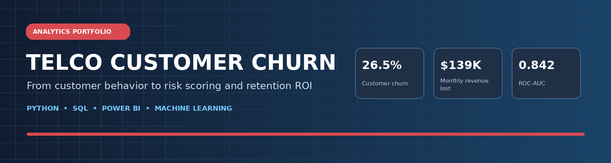
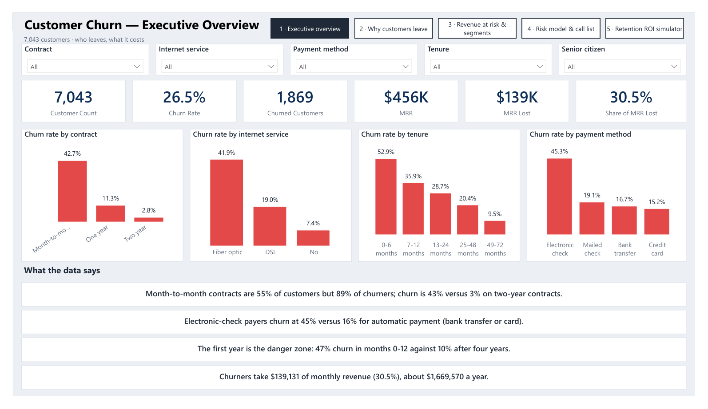
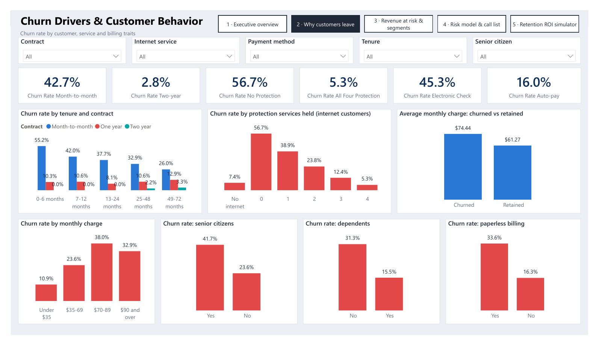
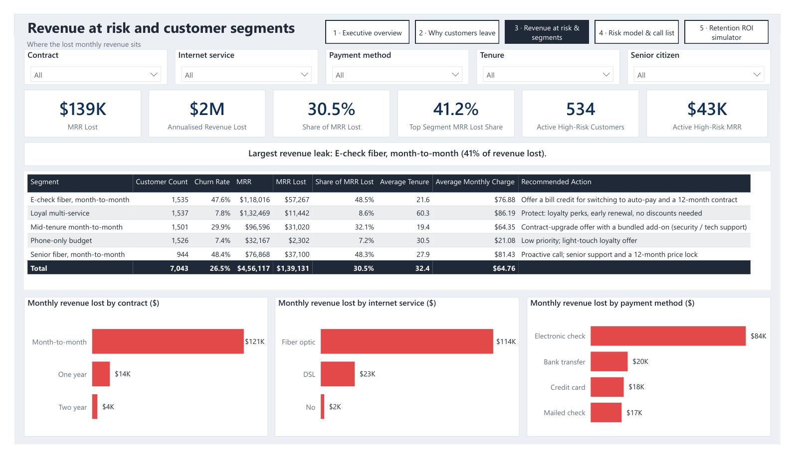
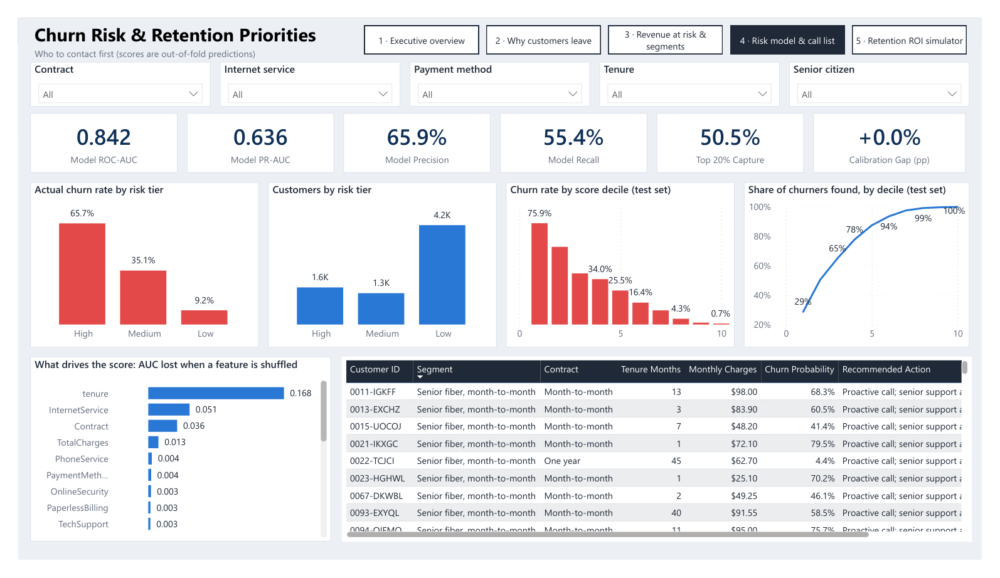
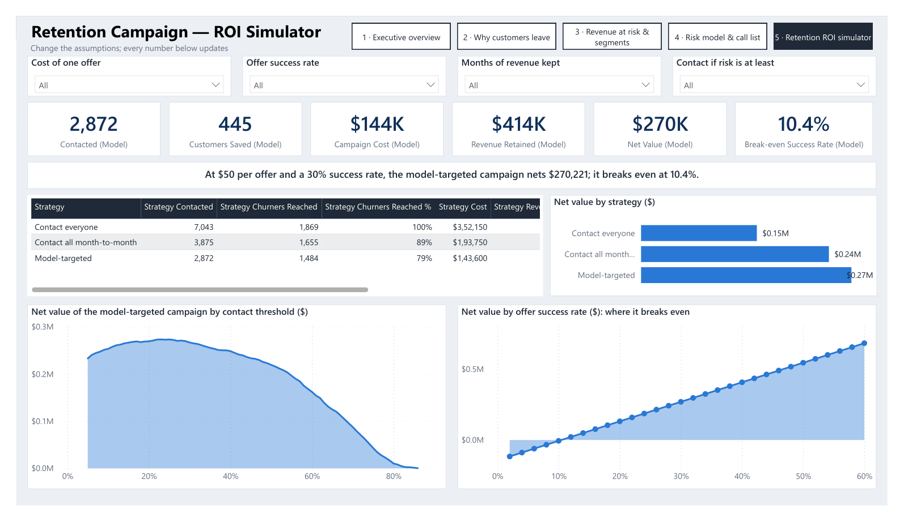

<div align="center">
  

  # Telco Customer Churn Analytics

  **From customer churn analysis to risk-based retention decisions**

  
  
  
  
  

  *An end-to-end analytics case study combining data quality, exploratory analysis, SQL, machine learning, and a five-page Power BI report.*
</div>

---

## Contents

- [Project deliverables](#project-deliverables)
- [Business snapshot](#business-snapshot)
- [Power BI report preview](#power-bi-report-preview)
- [Findings and business implications](#findings-and-business-implications)
- [Technology and skills](#technology-and-skills)
- [Quick start](#quick-start)
- [Open the Power BI report](#open-the-power-bi-report)
- [Repository structure](#repository-structure)
- [Reproducibility and validation](#reproducibility-and-validation)
- [Documentation](#documentation)
- [Limitations and responsible use](#limitations-and-responsible-use)
- [Data source and license](#data-source-and-license)

## Overview

Customer churn can reduce recurring revenue and increase the need to replace lost customers. This project uses IBM's public Telco Customer Churn sample dataset to examine which customer characteristics are associated with churn, quantify the monthly charges associated with churned customers, rank customer records by churn risk, and explore retention-campaign scenarios.

The repository is designed as a reproducible portfolio project, not a production system. It includes the raw sample data, a cleaning and feature-engineering pipeline, notebooks, reusable Python modules, SQL analyses, model evaluation outputs, tests, and a Power BI Project (`.pbip`).

**Start here:** read the [detailed project report](PROJECT_REPORT.md) for methodology and recommendations, the [model card](docs/MODEL_CARD.md) for model evaluation and limitations, or the [Power BI setup guide](docs/POWERBI_GUIDE.md) to open the interactive report.

## Project deliverables

| Deliverable | Where to find it | Purpose |
|---|---|---|
| Data-quality and EDA notebooks | `notebooks/01_data_cleaning_and_quality.ipynb`, `notebooks/02_eda_business_analysis.ipynb` | Inspect, clean, and explain customer churn patterns |
| Predictive modelling and risk strategy | `notebooks/03_modeling.ipynb`, `notebooks/04_segments_risk_and_strategy.ipynb` | Compare models, evaluate churn ranking, and prioritize retention outreach |
| Reusable Python code | `src/churn/` | Keep data preparation, feature engineering, model evaluation, and scoring logic reusable |
| SQL analysis | `sql/churn_analysis.sql` | Answer business questions independently and compare outputs with pandas |
| Power BI report | `powerbi/Telco Churn Report.pbip` | Explore KPIs, churn drivers, risk segments, and campaign scenarios |
| Published outputs | `reports/figures/`, `reports/tables/`, `reports/metrics.json` | Review charts, segment tables, model metrics, and prioritization outputs |
| Technical documentation | `PROJECT_REPORT.md`, `docs/` | Understand methodology, model behaviour, setup, and limitations |

## Business snapshot

| Measure | Result |
|---|---:|
| Customers in the sample | 7,043 |
| Customers labelled as churned | 1,869 |
| Overall churn rate | 26.5% |
| Total current monthly charges | About $456,117 |
| Monthly charges associated with churned customers | About $139,131 |
| Share of current monthly charges associated with churn | 30.5% |
| Held-out test ROC-AUC | 0.842 |
| Held-out test PR-AUC | 0.636 |
| Churners in the top-scored 20% of the test population | 50.5% |

**Interpretation note:** this source is a single snapshot. The $139,131 figure is the sum of current monthly charges for records whose churn label is `Yes`; it is not a verified amount that a retention campaign could recover.

## Power BI report preview

The report has five pages for stakeholders: an executive overview, churn drivers, revenue-at-risk segments, risk prioritization, and a retention ROI simulator. The images below are static previews; open the `.pbip` file in Power BI Desktop to use slicers, cross-filtering, and scenario controls.

<details open>
  <summary><strong>1 · Executive overview</strong></summary>
  
</details>

<details>
  <summary><strong>2 · Churn drivers</strong></summary>
  
</details>

<details>
  <summary><strong>3 · Revenue at risk</strong></summary>
  
</details>

<details>
  <summary><strong>4 · Churn risk and retention priorities</strong></summary>
  
</details>

<details>
  <summary><strong>5 · Retention campaign ROI simulator</strong></summary>
  
</details>

## Findings and business implications

- **Contract type is strongly associated with churn.** Month-to-month customers represent about 55% of the base and 88.6% of churned records; the churn rate in that contract group is 42.7%. Two-year customers churn at about 2.8% in this sample.
- **Early tenure is a risk period.** The 0–6 month cohort has a 52.9% churn rate, compared with 9.5% in the 49–72 month cohort.
- **Some groups concentrate charges associated with churn.** The exact month-to-month + fiber optic + electronic-check combination contains 1,307 records, has a 60.4% churn rate, and has about $68.3K in monthly charges associated with churn.
- **A separate rule-based group is also high-risk.** Month-to-month fiber customers with neither online security nor tech support number 1,524, have a 60.7% churn rate, and account for 49.5% of churned customers. This definition differs from the electronic-check group above.
- **Protection services are associated with lower churn.** Among internet customers, churn is 56.7% for customers with none of four protection/support services and 5.3% for customers with all four. This observational analysis does not prove causation.
- **Risk ranking can help prioritize outreach.** The highest-scored 20% of the held-out test population contains 50.5% of its churned customers. Scores in this snapshot are retrospective rankings, not validated forecasts of future churn.
- **Campaign economics depend on assumptions.** Offer cost, save rate, and the revenue-retention horizon are configurable scenario inputs; the result needs real-world validation, ideally through an A/B test.

The detailed methodology and recommendations are in [the project report](PROJECT_REPORT.md).

## Technology and skills

| Area | Used in this project |
|---|---|
| Data preparation | Python, pandas, NumPy, reusable cleaning functions, quality checks |
| Analysis and statistics | Exploratory analysis, cohort comparisons, chi-square tests, Mann–Whitney tests, effect sizes |
| SQL | CTEs, joins, conditional aggregation, window functions, churn analysis, cumulative/Pareto summaries |
| Machine learning | scikit-learn pipeline, feature engineering, stratified holdout, cross-validation, model comparison, ROC-AUC, PR-AUC, Brier score, threshold selection |
| BI and communication | Power BI `.pbip`, semantic model, DAX measures, slicers, cross-filtering, customer risk tiers, ROI scenarios |
| Reproducibility | Build scripts, automated tests, Power BI reference checks, GitHub Actions CI |

## Quick start

### Requirements

- Python **3.13 recommended** (also covered by CI alongside Python 3.11).
- Power BI Desktop on Windows to open and refresh the interactive report.
- Git is optional if you download the ZIP instead of cloning the repository.

### 1. Create an environment and install the project

From the repository root, run these commands in Windows PowerShell:

```powershell
py -3.13 -m venv .venv
.\.venv\Scripts\Activate.ps1
python -m pip install --upgrade pip
python -m pip install -e .
```

`requirements.txt` pins scikit-learn to the version used to create the included serialized model. Keep that version aligned when loading `models/churn_model.joblib`; scikit-learn explicitly warns that cross-version model loading may be unreliable.

### 2. Check the included data and outputs

```powershell
python scripts/init.py --check
python -m unittest discover -s tests -v
```

The optional Power BI schema test is skipped unless `MS_SCHEMAS` points to a local checkout of Microsoft's JSON schemas. The rest of the test suite does not require Power BI Desktop.

### 3. Rebuild the analysis

```powershell
python scripts/run_all.py
```

This runs the cleaning/EDA, modelling, segment/risk, and SQL build scripts in sequence. It regenerates analysis outputs and the saved model; review the generated changes before committing them. Use the dependency versions in `requirements.txt` for the intended reproducible environment.

### 4. Score a raw customer export (optional)

The scoring command accepts a CSV with the raw dataset's feature columns. `Churn` is optional for scoring new customers.

```powershell
python -m churn.predict --input path\to\new_customers.csv --output scored.csv
```

The output includes the customer key, contract, tenure, monthly charge, churn probability, and risk tier. `scored.csv` is excluded by `.gitignore` to help prevent accidental commits of one-off exports. Do not treat these scores as validated future predictions without time-based validation on suitable data.

## Open the Power BI report

1. Run `python scripts/init.py` from the repository root. This sets the report's `RepoRoot` parameter to the local folder path.
2. Open `powerbi/Telco Churn Report.pbip` in Power BI Desktop and select **Refresh**.
3. When preparing a commit, run `python scripts/init.py --reset` to restore the repository's generic placeholder path.

Power Query needs an absolute local path, so the initialization step is necessary after moving or extracting the project. See the [Power BI setup guide](docs/POWERBI_GUIDE.md) and [DAX measure reference](docs/POWERBI_MEASURES.md).

## Repository structure

```text
.
├── .github/workflows/          # Continuous integration
├── data/
│   ├── raw/                    # Original public sample dataset
│   ├── processed/              # Cleaned analysis dataset
│   └── DATA_DICTIONARY.md      # Source, field definitions, and quality notes
├── docs/
│   ├── images/                 # README banner, report previews, layout wireframes
│   ├── MODEL_CARD.md           # Model purpose, evaluation, risks, limitations
│   ├── POWERBI_GUIDE.md        # Report setup and troubleshooting
│   └── POWERBI_MEASURES.md     # DAX measure reference
├── models/                     # Serialized scikit-learn pipeline
├── notebooks/                  # Cleaning, EDA, modelling, segments, strategy
├── powerbi/                    # Power BI report and semantic model (.pbip)
├── reports/
│   ├── figures/                # Analysis and modelling charts
│   ├── tables/                 # Metrics, segment outputs, SQL outputs, risk scores
│   └── metrics.json            # Model evaluation metrics and assumptions
├── scripts/                    # Build, SQL, initialization, validation utilities
├── sql/                        # Reusable SQL business queries
├── src/churn/                  # Reusable cleaning, feature, model, scoring code
├── tests/                      # Data, prediction, SQL parity, Power BI checks
├── CHANGELOG.md
├── LICENSE
├── Makefile
├── PROJECT_REPORT.md
├── pyproject.toml
├── requirements.txt
└── requirements-dev.txt
```

## Reproducibility and validation

- `python scripts/run_all.py` rebuilds the main analysis outputs from the raw CSV.
- `python -m unittest discover -s tests -v` runs the automated test suite.
- `python scripts/check_refs.py powerbi` checks that the Power BI field references resolve.
- `python scripts/init.py --check` verifies required input/output tables and their expected dimensions.
- `.github/workflows/ci.yml` runs the pipeline and tests on supported Python versions, with a separate Power BI validation job.

The Power BI project has been checked for file structure and field-reference consistency. Automated schema validation is useful, but it cannot guarantee that every visual renders identically in every Power BI Desktop version.

## Documentation

- [Detailed project report](PROJECT_REPORT.md)
- [Data dictionary](data/DATA_DICTIONARY.md)
- [Model card](docs/MODEL_CARD.md)
- [Power BI setup guide](docs/POWERBI_GUIDE.md)
- [Power BI measure reference](docs/POWERBI_MEASURES.md)
- [Changelog](CHANGELOG.md)

## Limitations and responsible use

- This is a public sample dataset for a fictional telecom provider, not a real operator's customer base.
- The data is a single snapshot without event dates. The model does not establish when a customer will leave and is not validated as a forward-looking production model.
- Observed relationships do not establish that a factor causes churn or that a retention offer will change customer behaviour.
- Model performance and score calibration may change on a different population or future period. Validate on suitable, time-based data before operational use.
- ROI outputs depend on assumptions about offer cost, save rate, and how long retained revenue is counted. Run a controlled test before scaling a campaign.
- Use scores to support human-reviewed outreach, not to deny service or make automatic pricing decisions.

## Data source and license

The dataset is the IBM Telco Customer Churn public sample. Source and data notes are documented in [the data dictionary](data/DATA_DICTIONARY.md). Project code is distributed under the [MIT License](LICENSE).
